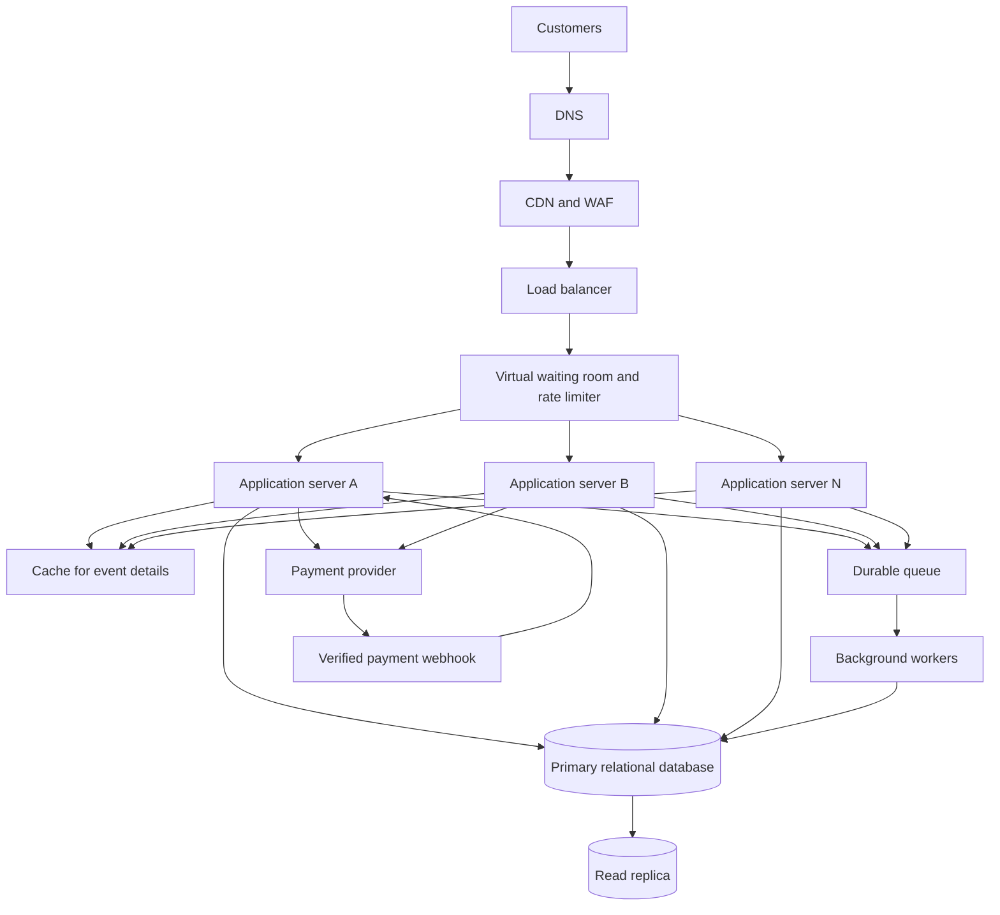

# TicketHub: Ticketing System Design

## 1. Requirements

### Functional requirements

1. Users can register, sign in, and manage their accounts.
2. Users can browse, search, and filter concerts and events by name, date, venue, and category.
3. Users can view event details, seat maps, seat availability, and prices.
4. Signed-in users can temporarily hold available seats while completing checkout.
5. Users can pay for orders and receive confirmed tickets.
6. Users can view their orders and tickets, including seat numbers and event details.
7. The system can release expired unpaid seat holds.
8. Administrators can create events, configure seats and prices, and monitor ticket sales.

### Non-functional requirements

- **Speed:** Event pages should normally load in under 2 seconds at the 95th percentile. Seat-hold requests should normally complete in under 1 second, excluding payment-provider delays.
- **Correctness:** A seat must never be sold to two customers. An order is confirmed only after payment is verified. The server must recheck seat availability and price.
- **Fairness:** A virtual waiting room controls entry during popular sales. Rate limits and queue tokens help prevent bots and aggressive refreshing from overwhelming the service.
- **Availability:** Browsing should continue where possible if purchasing or payment services are temporarily unavailable. The system must not confirm an uncertain purchase.
- **Security:** Use HTTPS, hashed passwords, access controls, input validation, rate limits, and verified payment webhooks. Never store raw card details.
- **Scalability:** The application must handle sudden traffic spikes without sending every request directly to the database.
- **Reliability:** Confirmed orders must survive application failures. Backups and a tested recovery process are required.
- **Monitoring:** Track response times, errors, queue length, payment failures, and database lock waits.

## 2. Traffic and capacity estimates

These are estimates for planning, not measured production results.

### Normal traffic

- Registered users: **2,000,000**
- Daily visitors: **50,000**
- Pages per visitor: **10**
- Page views per day: 50,000 × 10 = **500,000**
- Average page views per second: 500,000 ÷ 86,400 ≈ **5.8**
- Tickets sold per day: **5,000**

Assume each page view triggers an average of four API requests. That gives:

500,000 × 4 ÷ 86,400 ≈ **23 API requests per second on average**.

This assumes requests are spread evenly over 24 hours. Actual traffic will be uneven, with higher daytime and event-related peaks.

### Popular concert sale

- People trying to buy: **200,000**
- Seats available: **20,000**
- Sale window: **10 minutes = 600 seconds**
- Average incoming buyers: 200,000 ÷ 600 ≈ **333 buyers per second**
- Demand-to-supply ratio: 200,000 ÷ 20,000 = **10 buyers per seat**

Assume each buyer makes five API requests during the purchase flow:

200,000 × 5 ÷ 600 ≈ **1,667 API requests per second**.

This is an average over the sale window, not the maximum burst. As an initial stress-test target, the system should be tested at **5,000 requests per second**, then adjusted using measured performance.

### Comparison and response

The estimated sale traffic of 1,667 requests per second is about **72 times** the estimated normal average of 23 requests per second. The comparison is approximate because the normal estimate includes browsing, while the sale estimate focuses on purchase-flow requests.

TicketHub should use a virtual waiting room, rate limiting, caching for public event details, horizontally scaled application servers, and controlled database writes. It should not allow all 200,000 buyers to compete directly for database connections at once.

Since only 20,000 seats exist, not every buyer can succeed. The system must allocate seats safely, explain unsuccessful attempts clearly, and prevent users from gaining an unfair advantage through repeated requests.

## 3. API design

The API uses HTTPS and JSON. Authenticated endpoints identify the user through their session or access token, rather than trusting a user ID supplied in the request body.

| Method and endpoint | Purpose | Success response |
|---|---|---|
| `GET /api/events?query=&date=&page=` | Browse and search events | `200 OK` |
| `GET /api/events/{eventId}` | View event details | `200 OK` |
| `GET /api/events/{eventId}/seats` | View seats, prices, and availability | `200 OK` |
| `POST /api/seat-holds` | Temporarily hold available seats | `201 Created` |
| `DELETE /api/seat-holds/{holdId}` | Release a seat hold | `204 No Content` |
| `POST /api/orders` | Create an order from valid holds | `201 Created` |
| `POST /api/orders/{orderId}/payment` | Start a payment attempt | `202 Accepted` while pending |
| `GET /api/me/tickets` | View the signed-in user's tickets | `200 OK` |
| `GET /api/me/orders/{orderId}` | View a particular order | `200 OK` |

A request to hold two seats could look like this:

```json
{
  "eventId": "evt_204",
  "seatIds": ["seat_A12", "seat_A13"],
  "idempotencyKey": "hold-unique-client-key"
}
```

A successful response:

```json
{
  "holdId": "hold_8021",
  "status": "active",
  "expiresAt": "2026-11-01T12:05:00Z",
  "seatIds": ["seat_A12", "seat_A13"]
}
```

If a seat is no longer available, return `409 Conflict` and do not leave a partial hold behind.

Creating an order:

```json
{
  "holdId": "hold_8021",
  "idempotencyKey": "order-unique-client-key"
}
```

Example response:

```json
{
  "orderId": "ord_5018",
  "status": "pending_payment",
  "currency": "KES",
  "totalAmount": 8000
}
```

The server calculates the total using stored prices and verifies that the hold belongs to the signed-in user and has not expired. It must not trust a total sent by the browser. Payment callbacks must be verified and safe to retry.

## 4. Data model

PostgreSQL is suitable because ticket allocation and order creation need transactions, relationships, and database constraints.

### Tables and relationships

- **users:** Stores user accounts. One user can create many orders and seat holds.
- **events:** Stores event details. One event has many seats and orders.
- **seats:** Stores each seat's event, label, price, and current status. A seat label must be unique within its event.
- **seat_holds:** Stores temporary reservations, the user who created them, their status, and expiry time.
- **seat_hold_items:** Connects holds to the seats included in them.
- **orders:** Stores the buyer, event, total amount, and order status.
- **order_items:** Connects orders to seats and records the price charged for each seat.

Relationships:

- `users 1 — many orders`
- `events 1 — many seats`
- `events 1 — many orders`
- `seat_holds 1 — many seat_hold_items`
- `seats 1 — many historical seat_hold_items`
- `orders 1 — many order_items`

### Example SQL schema

```sql
CREATE TABLE users (
    id BIGSERIAL PRIMARY KEY,
    email VARCHAR(255) NOT NULL UNIQUE,
    password_hash TEXT NOT NULL,
    created_at TIMESTAMPTZ NOT NULL DEFAULT NOW()
);

CREATE TABLE events (
    id BIGSERIAL PRIMARY KEY,
    name VARCHAR(200) NOT NULL,
    venue VARCHAR(200) NOT NULL,
    starts_at TIMESTAMPTZ NOT NULL,
    status VARCHAR(20) NOT NULL
        CHECK (status IN ('draft', 'published', 'cancelled', 'completed'))
);

CREATE TABLE seats (
    id BIGSERIAL PRIMARY KEY,
    event_id BIGINT NOT NULL REFERENCES events(id),
    seat_label VARCHAR(30) NOT NULL,
    price_kes INTEGER NOT NULL CHECK (price_kes >= 0),
    status VARCHAR(20) NOT NULL DEFAULT 'available'
        CHECK (status IN ('available', 'held', 'sold')),
    UNIQUE (event_id, seat_label)
);

CREATE TABLE seat_holds (
    id BIGSERIAL PRIMARY KEY,
    user_id BIGINT NOT NULL REFERENCES users(id),
    event_id BIGINT NOT NULL REFERENCES events(id),
    status VARCHAR(20) NOT NULL
        CHECK (status IN ('active', 'expired', 'released', 'converted')),
    expires_at TIMESTAMPTZ NOT NULL,
    idempotency_key VARCHAR(100) NOT NULL UNIQUE,
    created_at TIMESTAMPTZ NOT NULL DEFAULT NOW()
);

CREATE TABLE seat_hold_items (
    hold_id BIGINT NOT NULL REFERENCES seat_holds(id),
    seat_id BIGINT NOT NULL REFERENCES seats(id),
    PRIMARY KEY (hold_id, seat_id)
);

CREATE TABLE orders (
    id BIGSERIAL PRIMARY KEY,
    user_id BIGINT NOT NULL REFERENCES users(id),
    event_id BIGINT NOT NULL REFERENCES events(id),
    status VARCHAR(30) NOT NULL
        CHECK (status IN ('pending_payment', 'paid', 'cancelled', 'refunded')),
    total_kes INTEGER NOT NULL CHECK (total_kes >= 0),
    idempotency_key VARCHAR(100) NOT NULL UNIQUE,
    created_at TIMESTAMPTZ NOT NULL DEFAULT NOW()
);

CREATE TABLE order_items (
    id BIGSERIAL PRIMARY KEY,
    order_id BIGINT NOT NULL REFERENCES orders(id),
    seat_id BIGINT NOT NULL REFERENCES seats(id),
    price_kes INTEGER NOT NULL CHECK (price_kes >= 0),
    status VARCHAR(20) NOT NULL
        CHECK (status IN ('pending', 'paid', 'cancelled', 'refunded'))
);

-- One seat cannot have multiple active or paid order items.
CREATE UNIQUE INDEX one_active_or_paid_order_per_seat
ON order_items (seat_id)
WHERE status IN ('pending', 'paid');
```

The application must also verify that each seat, hold, and order belongs to the same event. Production code should enforce this with suitable database constraints or transaction-level checks. An expired pending order item must be cancelled before its seat is released.

### Example SQL queries

Find available seats:

```sql
SELECT id, seat_label, price_kes
FROM seats
WHERE event_id = 204 AND status = 'available'
ORDER BY seat_label;
```

View a user's paid tickets:

```sql
SELECT o.id AS order_id, e.name AS event_name, e.starts_at,
       s.seat_label, oi.price_kes
FROM orders o
JOIN order_items oi ON oi.order_id = o.id
JOIN seats s ON s.id = oi.seat_id
JOIN events e ON e.id = o.event_id
WHERE o.user_id = 42
  AND o.status = 'paid'
  AND oi.status = 'paid'
ORDER BY e.starts_at;
```

Count tickets sold for each event:

```sql
SELECT e.id, e.name, COUNT(oi.id) AS tickets_sold
FROM events e
LEFT JOIN orders o ON o.event_id = e.id AND o.status = 'paid'
LEFT JOIN order_items oi ON oi.order_id = o.id AND oi.status = 'paid'
GROUP BY e.id, e.name;
```

### How double-booking is prevented

The browser's seat map can become outdated, so the database must make the final decision.

1. Start a database transaction when a user requests seats.
2. Lock the requested seat rows using `SELECT ... FOR UPDATE`, acquiring locks in a consistent order.
3. Recheck that all requested seats are available or have expired holds.
4. Create the hold and hold-item records and mark the seats held within the same transaction.
5. If any seat is unavailable, roll back the entire transaction. Do not hold only part of a multi-seat request.
6. Commit the transaction. A competing request must wait for the lock and then recheck the seat state, so it cannot also hold the same seat.
7. Give holds a short expiry, such as five minutes. A background worker and new hold requests can safely release expired holds.
8. After verified payment success, use another transaction to mark the order paid, mark the seats sold, convert the hold, and create paid order items.
9. Use database uniqueness constraints as a final safeguard and idempotency keys to stop retries creating duplicate orders or charges.

**Transactions, row locks, and constraints work together.** The frontend alone cannot prevent double-booking. The server must validate every hold and purchase against authoritative database state.

## 5. Architecture



### Components

- **DNS:** Directs users to the website.
- **CDN and WAF:** Serves static files close to users and filters malicious traffic. It must not cache private orders or treat cached seat availability as authoritative.
- **Load balancer:** Distributes requests across healthy application servers.
- **Virtual waiting room:** Controls how quickly buyers enter the purchase flow and helps prevent a sudden flood from overwhelming the database.
- **Application servers:** Handle API requests and can scale horizontally because they do not rely on local memory for shared session state.
- **Cache:** Stores relatively static event and venue information to reduce database load. The server rechecks live inventory before a hold or purchase.
- **Primary database:** Stores authoritative seat, hold, order, and payment state. Transactions and constraints protect correctness.
- **Read replica:** Serves suitable read-heavy queries and reports. Seat-hold and purchase decisions use the primary database to avoid stale availability.
- **Durable queue:** Buffers work such as notifications, payment reconciliation, and expiry jobs.
- **Background workers:** Process queued work independently of the user's request. Jobs must be safe to retry.
- **Payment provider and webhook:** Processes payment securely. The backend verifies callbacks and updates orders only after confirming payment status.

### How requests flow

**Browsing:** A user requests event details. Static files and suitable event information can be served through the CDN and cache. Seat availability is displayed to the user, but is revalidated against the primary database when the user requests a hold.

**Holding and paying:** The user enters through the waiting room and requests a hold. The application locks the seat rows, checks availability, and commits the hold in a transaction. The user then pays for an order created from that hold. After verifying payment, the backend atomically marks the order paid and the seats sold. Failed or expired holds are released according to the payment-reconciliation rules.

### Surviving the big sale

- Queue users before they reach the inventory database and admit them at a controlled rate.
- Scale stateless application servers horizontally and deploy across multiple availability zones where supported.
- Cache event details, but never trust cached availability to confirm a sale.
- Use connection pooling and limit database connections.
- Use database backups, replication, and a tested failover process.
- Make payment callbacks and background jobs idempotent.
- Monitor queue length, database lock waits, request latency, and payment-provider failures.
- If purchase processing becomes unsafe or unavailable, show a clear waiting or error state rather than falsely confirming a ticket.

## 6. Trade-offs

### Trade-off 1: Correctness vs. maximum throughput

Row locking and transactions add latency and can limit write throughput compared with eventually consistent designs. However, double-selling a seat is unacceptable. TicketHub prioritizes correctness for holds and purchases while scaling browsing separately with caches and read replicas.

### Trade-off 2: Waiting room vs. immediate access

A waiting room adds friction because customers may have to wait. However, it protects the service during a sudden spike and creates a more controlled admission process. Without it, aggressive refreshes and automated clients could overload the service and reduce fairness.

### Trade-off 3: Short holds vs. customer convenience

Short holds return abandoned seats to the available pool quickly, but a customer may lose a seat while completing payment. A clear countdown and reasonable expiry period help balance convenience with fair inventory turnover.

### Trade-off 4: Cache speed vs. freshness

Caching event details reduces latency and database load, but cached seat availability can be stale during a sale. TicketHub caches mostly static information and always rechecks availability on the primary database before holding or selling a seat.
